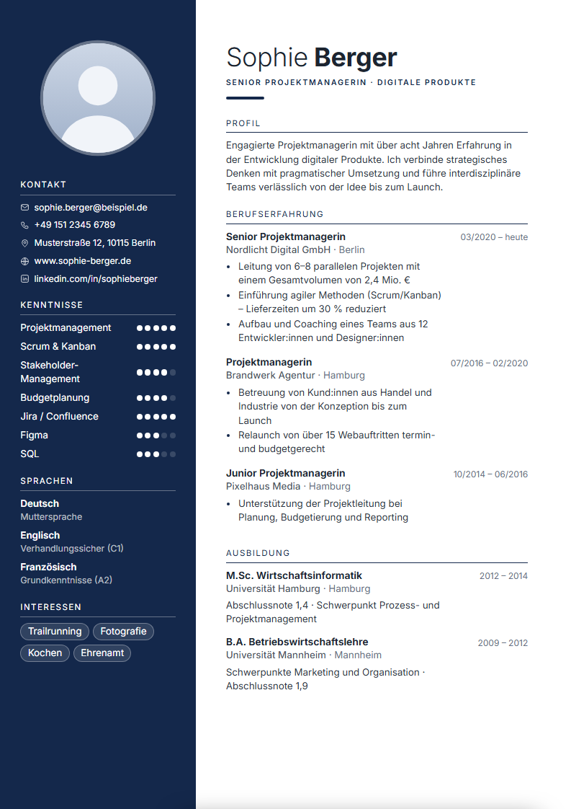
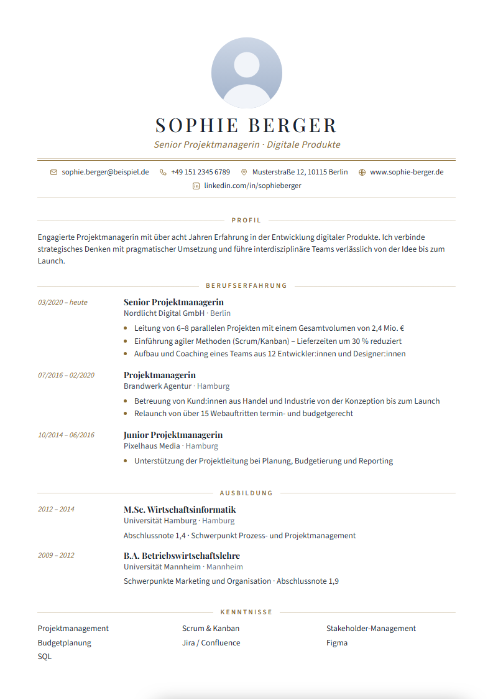
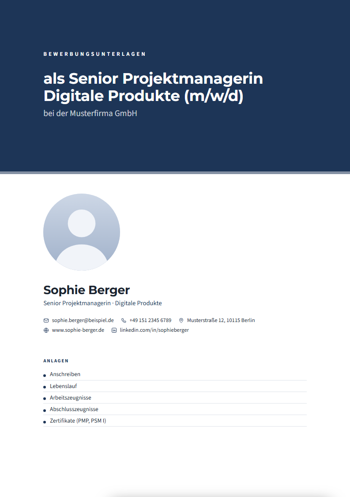

# CV-Editor · Bewerbungsstudio

Webtool zum Erstellen von **Lebenslauf, Anschreiben und Deckblatt** – direkt im Dokument bearbeiten, in verschiedenen Designs, als PDF exportieren.
Läuft komplett im Browser: kein Build, kein Server, kein Konto, keine Daten verlassen das Gerät.

<p>
  
  
  
</p>

## Starten

`index.html` per Doppelklick im Browser öffnen (Chrome, Edge, Firefox).

## Funktionen

- **Direkt im Dokument schreiben** – einfach in den Text klicken. Beim Überfahren von Einträgen erscheinen Werkzeuge (verschieben, duplizieren, einfügen, löschen). Text lässt sich fett, kursiv, unterstrichen und als Liste formatieren.
- **8 Vorlagen:** Modern (marineblaue Seitenleiste), Executive (dunkles Kopfband), Klassisch, Minimal, Elegant, Kreativ, Zeitstrahl, Tech.
- **Design anpassen:** Farbpalette (inkl. Marine-/Dunkelblau) und eigene Farbe, 9 Schriftpaare, Schriftgröße, Zeilen-/Abschnittsabstand, Seitenrand, Foto-Form, Darstellung der Kenntnisse (Punkte, Balken, Chips, Text).
- **Bewerbungsmappe:** Deckblatt, Anschreiben und Lebenslauf teilen Daten und Design. Ein Klick erzeugt ein PDF mit allen gewählten Dokumenten.
- **Echte A4-Seiten** mit automatischem Seitenumbruch (Überschriften bleiben beim ersten Eintrag, Seitenleisten laufen durch).
- **Anschreiben:** Empfänger, Betreff, Anrede, Absätze, Unterschrift (Handschrift oder Bild) und Textbausteine.
- **Bewerbungs-Check:** Hinweise zu Platzhaltern, fehlenden Angaben, Seiten- und Textlänge.
- **Musterdaten** überall vorausgefüllt – einfach überschreiben. Alternativ leere Bewerbung starten.
- **Mehrere Bewerbungen** verwalten, Export/Import als JSON, automatisches Speichern im Browser (localStorage), Undo/Redo.

## Bedienung

| Aktion | Wie |
| --- | --- |
| Text bearbeiten | direkt ins Dokument klicken |
| Neuer Eintrag | `Enter` in Kenntnissen, Kontakten, Anlagen, Absätzen |
| Eintrag entfernen | `Rücktaste` im leeren Feld oder Werkzeugleiste |
| Rückgängig / Wiederholen | `Strg+Z` / `Strg+Y` |
| PDF / Drucken | Button oben rechts oder `Strg+P` → im Druckdialog **„Als PDF speichern“** |
| Zoomen | `Strg+Mausrad` |

Wichtige Bewerbungen regelmäßig über das Menü `⋯` → *Projekt als JSON exportieren* sichern – gespeichert wird nur im Browser.

## Projektstruktur

```
index.html
css/    fonts.css (lokale Schriften) · doc.css (A4-Dokumente, alle Vorlagen) · app.css (Editor-Oberfläche)
js/     util · icons · data (Datenmodell, Musterdaten) · templates · render (Editor + Seitenumbruch) · app (UI, Speichern, Druck)
fonts/  woff2-Dateien (Inter, DM Sans, Source Sans 3, Montserrat, Playfair Display, Lora, EB Garamond, IBM Plex, Caveat – OFL-Lizenz)
docs/   Vorschaubilder für diese README
```

**Neue Vorlage hinzufügen:** Eintrag in `js/templates.js` ergänzen und einen CSS-Block `.tpl-<id>` in `css/doc.css` anlegen.

## Lizenzhinweis

Die enthaltenen Schriften stehen unter der SIL Open Font License (Quelle: Google Fonts).
